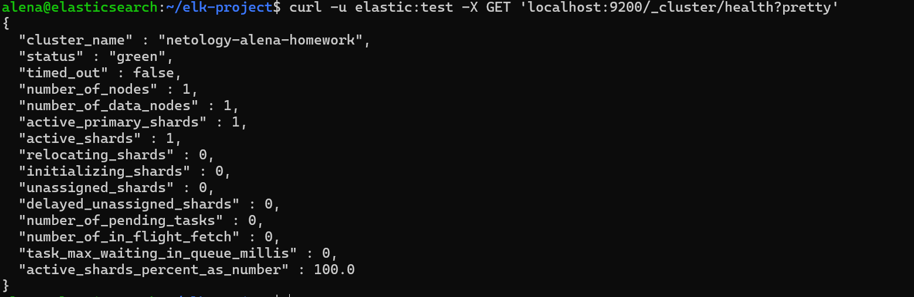
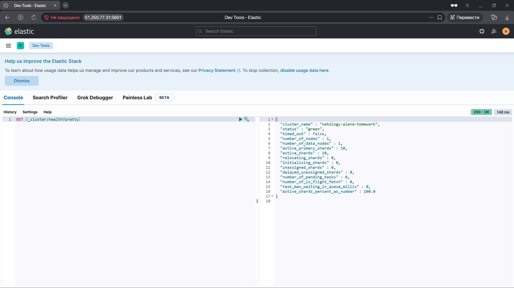
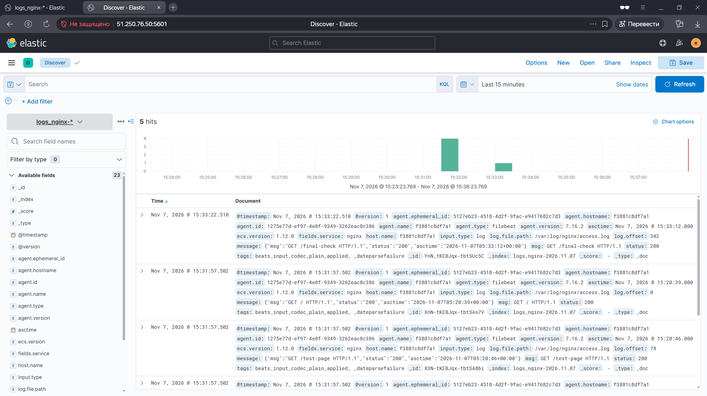
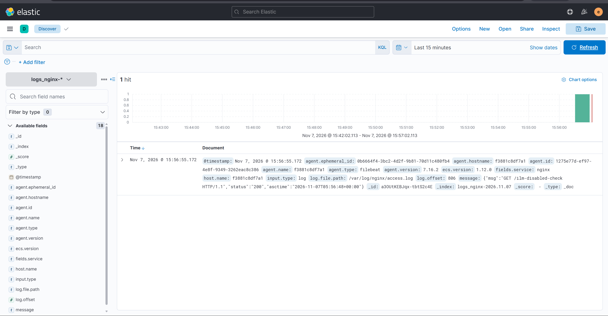

# Домашнее задание к занятию "`ELK`" - `Павлова Алена`

## Задание 1. Elasticsearch
Скриншот вывода `curl` с измененным `cluster_name` (`netology-alena-homework`):

---

## Задание 2. Kibana
Скриншот интерфейса Kibana с запросом `GET /_cluster/health?pretty`:

.png)

---

## Задание 3. Logstash и Nginx
Скриншот Kibana (Discover), где видны логи Nginx (`GET /final-check`), отправленные через Logstash:

---

## Задание 4. Filebeat
Скриншот 1 — терминал с `docker compose ps` (Logstash остановлен, Filebeat работает):
.png)

Скриншот 2 — Kibana (Discover), логи Nginx (`GET /ilm-disabled-check`), отправленные напрямую через Filebeat:

